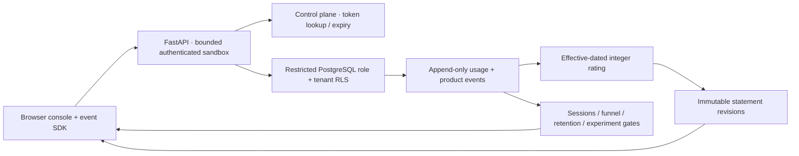

# Meterwork

**Explain a changed usage statement, down to the event and the price known at publication.**

[View the result](https://vasilendata.github.io/usage-metering-platform/#reconciliation) · [Inspect the case study](docs/LANDMARK.md) · [Run the independent reconciliation](verify_workload.py)

An API business needs to explain a usage statement when requests are retried, arrive late, or are corrected. Meterwork records immutable usage, applies effective-dated prices, and publishes traceable statement revisions. Its instrumented sandbox also measures signup, activation, API usage and a fixed-protocol onboarding experiment.

**Scope:** independent portfolio project. Seeded activity and recovery exercises are synthetic. Statements are non-binding estimates; no payments are collected. This is a bounded demonstrator, not a claim of enterprise-scale billing or real customer adoption.

## What to inspect

| Question | Evidence |
|---|---|
| Can retries charge twice? | Composite event identity, conflicting-payload rejection, concurrent replay test and executable local replay exercise. |
| What happens to late usage or corrections? | Immutable statement revisions; original outputs stay accessible; per-event price trace. |
| Can a backdated price rewrite history? | Separate business-effective and database-recorded clocks; historical knowledge cutoffs; validated event-level restatement bridges. |
| Do all accounts reconcile independently? | Deterministic multi-account exercise: fixture arithmetic, separately written SQL and every statement revision agree. [Measured results](web/landmark.json). |
| Can an omitted SQL tenant filter expose another account? | Forced PostgreSQL RLS under a non-owner role; direct cross-account read/write tests. |
| Do the guarantees survive the actual HTTP boundary? | [Uvicorn/PostgreSQL HTTP exercise](docs/API_RELIABILITY.md): eight concurrent clients, conflicting replays, correction/publication races, expiring credentials and malformed JSON. Raw results are attached to each successful CI run. |
| Does interruption corrupt the published result? | Synchronized publisher process termination, rollback, replay and `pg_dump` restoration in `verify_release.py`. |
| Does product data justify a launch? | Instrumented browser SDK, assignment/exposure checks, ordered funnel, mature retention cohorts and fixed-horizon decision gates. |

**Inspect the engineering:** [contract](docs/CONTRACT.md), [product definitions](docs/PRODUCT_ANALYTICS.md), [delivery prompt and primary references](docs/DELIVERY_PROMPT.md), [dated recovery evidence](docs/release-2026-11-12.json), and [CI](https://github.com/VasilenData/usage-metering-platform/actions).

## Architecture



Python 3.12, FastAPI, PostgreSQL 17+, plain JavaScript ES modules, pytest, Hypothesis, Docker Compose and GitHub Actions. No message broker is added: the demonstrated workload fits a transactional database, and a durable commit is the ingestion acknowledgement.

## Run locally

Set a URL-safe local development `POSTGRES_PASSWORD` and run `docker compose up --build`. Open `http://localhost:8000`. PostgreSQL is on the private Compose network; only the app is bound to loopback.

Alternatively install `requirements-dev.txt`, create a PostgreSQL database, set `DATABASE_URL`, and run `uvicorn app:app --host 127.0.0.1 --port 8000`. The startup identity needs role/schema creation privileges in this **dedicated** demonstrator database. Do not point it at an employer or shared production database. No secrets belong in this repository.

## Verify

Use a disposable PostgreSQL database whose name ends in `_test`; set its URL in `TEST_DATABASE_URL`:

```sh
pip install -r requirements-dev.txt
ruff check .
ruff format --check .
pytest -q
node --test tests/test_sdk.mjs
node --test tests/test_landmark.mjs
python verify_workload.py --accounts 24 --originals 450 --clients 8 --output local-evidence/workload.json
python verify_release.py --output local-evidence/release.json
python verify_http.py --output local-evidence/http.json
```

The integration suite requires PostgreSQL and fails when its test database is absent. The release exercise also needs matching-version `pg_dump`/`pg_restore` in PATH, or `--pg-bin /path/to/postgresql/bin`. It creates and drops only a uniquely named disposable restore database. Keep generated dumps private; even this synthetic demonstration has hashed sandbox tokens.

The HTTP exercise starts and stops real loopback Uvicorn processes, uses eight concurrent clients, and removes only its own temporary accounts. CI runs it against PostgreSQL 17 on **GitHub-hosted Linux**, also reproducing the pre-fix malformed-input failure from a pinned historical checkout. The `postgres-test-evidence` artifact contains request status counts, observed latency, SQL reconciliation, exact source hashes and fresh recovery results. These are bounded synthetic exercises, separate from the older local Windows Store-call measurements. The November 12 report stays immutable and is checked against its original source.

The implementation and review are AI-assisted. They do not establish independent human review, the owner's unaided interview performance, real customer use or sustained production operation. [Review scope and next evidence](docs/API_RELIABILITY.md#what-this-does-not-establish) make those gaps explicit.

When run locally, the API console exposes OpenAPI at `/openapi.json`. Create a sandbox, make an instrumented API call, replay it, then inspect the statement and product report. Tokens remain in browser memory and expire after one hour.

## Public result

[View the read-only evidence snapshot](https://vasilendata.github.io/usage-metering-platform/). The public website has **no hosted backend**. Its synthetic ledger, prices and product events are downloadable in [sources.json](web/sources.json); `python export_snapshot.py --verify` reconstructs every statement at its original knowledge cutoff and regenerates the product report. CI verifies this bundle before publishing it. The interactive API and failure exercises are available when run locally.
