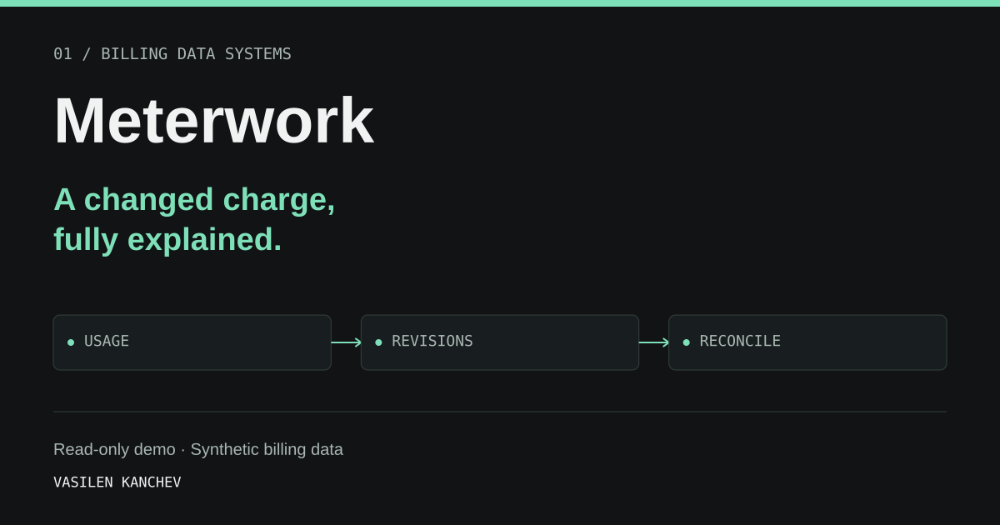
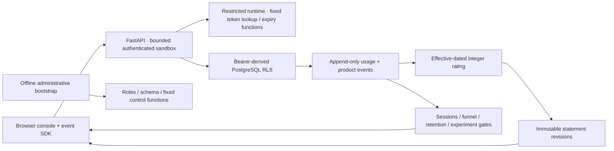

# Meterwork



**Explain a changed usage statement, down to the event and the price known at publication.**

[View the result](https://vasilendata.github.io/usage-metering-platform/#reconciliation) · [Inspect the reliability proof](docs/MULTIWORKER.md) · [Read the case study](docs/LANDMARK.md) · [Run the independent reconciliation](verify_workload.py)

An API business needs to explain a usage statement when requests are retried, arrive late, or are corrected. Meterwork records immutable usage, applies effective-dated prices, and publishes traceable statement revisions. Its instrumented sandbox also measures signup, activation, API usage and a fixed-protocol onboarding experiment.

**Scope:** independent portfolio project. Seeded activity and recovery exercises are synthetic. Statements are non-binding estimates; no payments are collected. This is a bounded demonstrator, not a claim of enterprise-scale billing or real customer adoption.

A per-process quota let one account double its allowance across two API workers. I replaced it with bounded PostgreSQL admission state behind a restricted function, then killed a worker after an independently observed commit and retried through its survivor. The synthetic local exercise passed **32 checks**; a separate 30-second mixed load completed **350 requests with no HTTP errors** across two workers (p95 **199 ms**). [Inspect the measured result, failure proof and limitations](docs/MULTIWORKER.md) · [Raw evidence](docs/multiworker-2026-11-14.json).

**Usage → finance:** exported actual restricted-API statement revisions and source histories into a separate USD reconciliation scenario. Exact replay kept all bundle bytes unchanged; a late correction preserved the previous revision and explained both the **-150-cent invoice change** and **+1,500-microUSD rounding residual change**. The local PostgreSQL/HTTP export exercise passed **14 checks**. [View the correction](https://vasilendata.github.io/usage-metering-platform/finance-bridge/) · [Inspect the contract and scope](docs/FINANCE_BRIDGE.md).

**A contended database, a recoverable request:** fixed a malformed correction that returned HTTP 500 and bounded previously unbounded runtime SQL paths. Real locked writes, publication and sandbox provisioning now return protected 503s; the old statement survives and a same-ID retry reconciles exactly once. A separate synthetic local exercise passes **17 checks over 14 HTTP requests**. [Inspect the observed failure and recovery](docs/REQUEST_RECOVERY.md).

## What to inspect

| Question | Evidence |
|---|---|
| Can retries charge twice? | Composite event identity, conflicting-payload rejection, concurrent replay test and executable local replay exercise. |
| What happens to late usage or corrections? | Immutable statement revisions; original outputs stay accessible; per-event price trace. |
| Can a backdated price rewrite history? | Separate business-effective and database-recorded clocks; historical knowledge cutoffs; validated event-level restatement bridges. |
| Do all accounts reconcile independently? | Deterministic multi-account exercise: fixture arithmetic, separately written SQL and every statement revision agree. [Measured results](web/landmark.json). |
| Can a forged tenant selector expose another account? | [Token-derived RLS and a separate runtime identity](docs/RUNTIME_SECURITY.md); direct SQL probes omit filters, change tenant UUIDs and attempt privilege escalation. |
| Can one account consume another account's request allowance? | Separate authenticated-account and anonymous-peer quotas; real HTTP exercise exhausts A, then requires B to succeed from the same peer. |
| Do the guarantees survive the actual HTTP boundary? | [Uvicorn/PostgreSQL HTTP exercise](docs/API_RELIABILITY.md): eight concurrent clients, conflicting replays, correction/publication races, expiring credentials and malformed JSON. Raw results are attached to each successful CI run. |
| Does interruption corrupt the published result? | Synchronized publisher process termination, rollback, replay and `pg_dump` restoration in `verify_release.py`. |
| Can the current restricted API restart after restoration? | [Fresh-database runtime recovery](docs/RUNTIME_RESTORE.md): closed admission, repaired function ownership/ACLs, complete data fingerprints, real HTTP replay and account-denial checks, then a second process restart. |
| Does product data justify a launch? | Instrumented browser SDK, assignment/exposure checks, ordered funnel, mature retention cohorts and fixed-horizon decision gates. |

**Earlier runtime evidence (13 November):** [126 Python tests and 27 runtime acceptance checks](docs/RUNTIME_SECURITY.md#observed-result--13-november-2026), with separate 363-request fairness and 345-request HTTP regression exercises on synthetic GitHub-hosted PostgreSQL.

**Inspect the engineering:** [contract](docs/CONTRACT.md), [product definitions](docs/PRODUCT_ANALYTICS.md), [delivery prompt and primary references](docs/DELIVERY_PROMPT.md), [dated recovery evidence](docs/release-2026-11-12.json), and [CI](https://github.com/VasilenData/usage-metering-platform/actions).

## Architecture



Python 3.12, FastAPI, PostgreSQL 17+, plain JavaScript ES modules, pytest, Hypothesis, Docker Compose and GitHub Actions. No message broker is added: the demonstrated workload fits a transactional database, and a durable commit is the ingestion acknowledgement.

## Run locally

**New here? [Follow the first-use guide](https://vasilendata.github.io/usage-metering-platform/start/)** to create local credentials, launch Compose, send/replay/correct an event and export a reconciled USD 3.00 → 2.50 statement. [Installation and recovery instructions](docs/FIRST_USE.md) cover diagnostics, reruns, stop/start, backups and upgrades. Python 3.12+ and Docker Compose v2; local computation, no hosted backend or cloud account.

```sh
python -m starter.local doctor
python -m starter.local setup
python -m starter.local up
python -m starter.client
```

Set separate URL-safe local development `POSTGRES_PASSWORD` and `METER_RUNTIME_PASSWORD` values (the runtime password must be at least 24 characters), then run `docker compose up --build`. Open `http://localhost:8000`. Compose runs an explicit administrative bootstrap job before starting the application. Only the bootstrap receives the administrative DSN; the app receives `METER_RUNTIME_DATABASE_URL` for `meter_api_runtime`. PostgreSQL stays on the private Compose network and only the app binds to loopback.

For a manual installation, run `python bootstrap_runtime.py` in a separate administrative process with `ADMIN_DATABASE_URL` and `METER_RUNTIME_PASSWORD`. Start a clean shell containing only `METER_RUNTIME_DATABASE_URL`, then use `uvicorn app:app --host 127.0.0.1 --port 8000 --no-proxy-headers --no-access-log`. The HTTP process rejects administrative/test DSN environment variables and unsafe PostgreSQL identities. Multiple workers share PostgreSQL admission windows; read the [migration and measured limits](docs/MULTIWORKER.md) before changing worker count. See [credential boundaries and reproduction](docs/RUNTIME_SECURITY.md) before adapting the launch configuration. Use a dedicated demonstration database; no credentials belong in this repository.

## Verify

Use a disposable PostgreSQL database whose name ends in `_test`; set its URL in `TEST_DATABASE_URL`:

```sh
pip install -r requirements-dev.txt
ruff check .
ruff format --check .
pytest -q
node --test tests/test_sdk.mjs
node --test tests/test_landmark.mjs
python verify_workload.py --accounts 24 --originals 450 --clients 8 --output local-evidence/workload.json
python verify_release.py --output local-evidence/release.json
python verify_http.py --output local-evidence/http.json
python verify_runtime.py --output local-evidence/runtime.json
python verify_runtime_restore.py --output local-evidence/runtime-restore.json
python verify_multiworker.py --phase-seconds 10 --output local-evidence/multiworker.json
python verify_finance_export.py --output local-evidence/finance-export-ci
python verify_request_recovery.py --output local-evidence/request-recovery.json
```

The integration suite requires PostgreSQL and fails when its test database is absent. The release exercise also needs matching-version `pg_dump`/`pg_restore` in PATH, or `--pg-bin /path/to/postgresql/bin`. It creates and drops only a uniquely named disposable restore database. Keep generated dumps private; even this synthetic demonstration has hashed sandbox tokens.

The HTTP exercise starts and stops real loopback Uvicorn processes, uses eight concurrent clients, and removes only its own temporary accounts. CI runs it against PostgreSQL 17 on **GitHub-hosted Linux**, also reproducing the pre-fix malformed-input failure from a pinned historical checkout. The `postgres-test-evidence` artifact contains request status counts, observed latency, SQL reconciliation, exact source hashes and fresh recovery results. `runtime-ci.json` adds actual permission denials, a legacy-selector counterexample, token-derived row scope and separate request-allowance checks. Each report records the source revision it actually tested. These are bounded synthetic exercises, separate from the older local Windows Store-call measurements. The November 12 report stays immutable and is checked against its original source.

The implementation and review are AI-assisted. They do not establish independent human review, the owner's unaided interview performance, real customer use or sustained production operation. [Review scope and next evidence](docs/API_RELIABILITY.md#what-this-does-not-establish) make those gaps explicit.

When run locally, the API console exposes OpenAPI at `/openapi.json`. Create a sandbox, make an instrumented API call, replay it, then inspect the statement and product report. Tokens remain in browser memory and expire after one hour.

## Public result

[View the read-only evidence snapshot](https://vasilendata.github.io/usage-metering-platform/). The public website has **no hosted backend**. Its synthetic ledger, prices and product events are downloadable in [sources.json](web/sources.json); `python export_snapshot.py --verify` reconstructs every statement at its original knowledge cutoff and regenerates the product report. CI verifies this bundle before publishing it. The interactive API and failure exercises are available when run locally.
